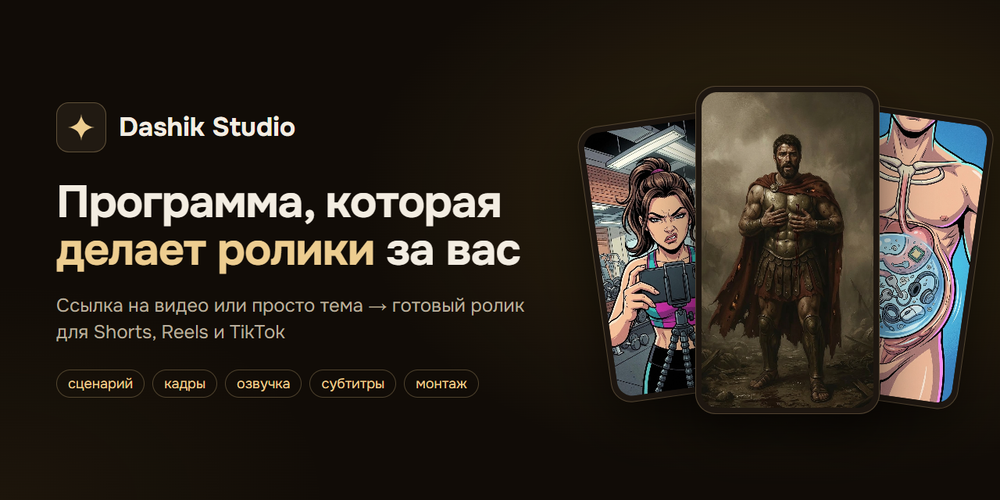
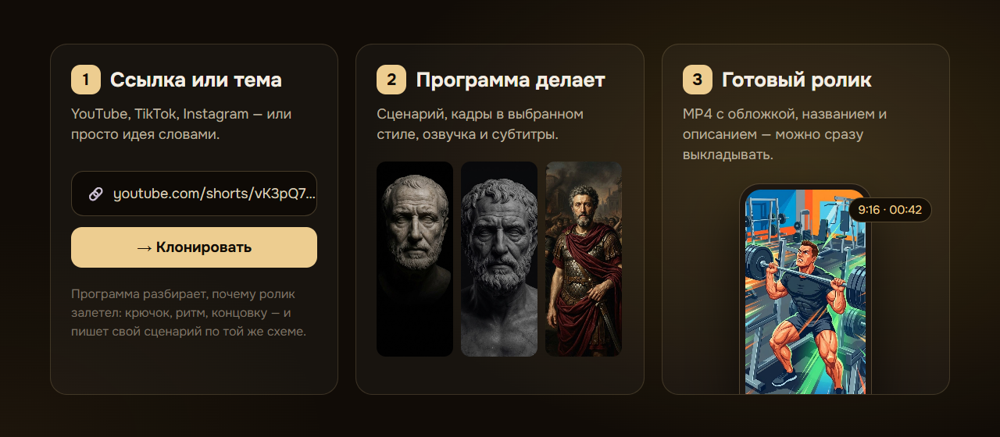
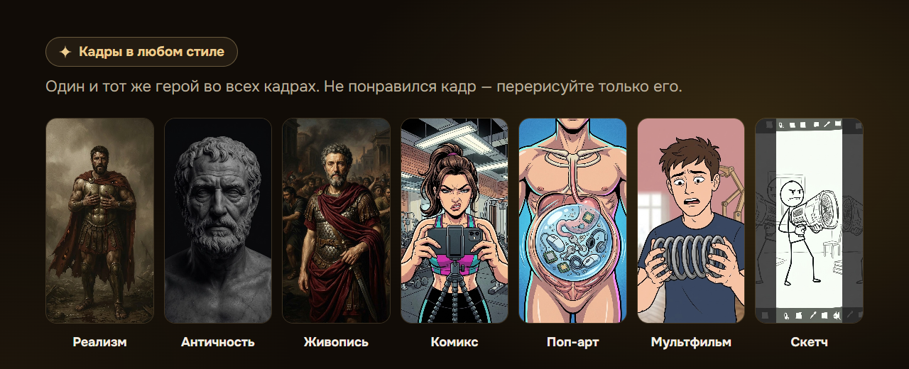

  

  
  
  

<h3 align="center">
  <a href="https://dashik.pro/download/windows">⬇ Скачать для Windows</a> &nbsp;·&nbsp;
  <a href="https://dashik.pro/download/linux">⬇ Скачать для Linux</a> &nbsp;·&nbsp;
  <a href="https://dashik.pro/?src=github">Сайт</a> &nbsp;·&nbsp;
  <a href="https://t.me/dashikstudio">Канал с новостями</a>
</h3>

 

**Dashik Studio** — программа для компьютера, которая делает короткие вертикальные ролики для YouTube Shorts, Reels и TikTok почти без ручной работы. Вставляете ссылку на чужой удачный ролик или просто пишете тему — получаете готовый MP4: сценарий, кадры, озвучка, субтитры и монтаж.

За нейросети отдельно платить не нужно: программа работает через ваши бесплатные аккаунты Google и Яндекса.

## Как это работает

1. **Ссылка или тема.** YouTube, TikTok, Instagram — или идея словами.
2. **Программа делает.** Разбирает, почему образец залетел (крючок, ритм, концовка), пишет свой сценарий по той же схеме, рисует кадры, озвучивает и накладывает субтитры.
3. **Готовый ролик.** MP4 с обложкой, названием и описанием. Не понравился один кадр — перерисуйте только его.

## Кадры в любом стиле

## Что умеет

- **Smart-Clone** — разбирает удачный ролик и собирает свой: новый сюжет и новые кадры, не копия
- **ИИ-сценарист** — пишет под ваш канал, помнит, где зрители уходят, и не повторяет прошлые темы
- **Кадры** — любой стиль, один и тот же герой во всех кадрах, своя библиотека стилей
- **Оживление кадров** — ключевые сцены превращаются в короткие видео, и ролик не похож на слайд-шоу
- **Озвучка и субтитры** — живые голоса на 74 языках, субтитры точно по словам; можно и своим голосом
- **Ролики без озвучки** — под музыку, с надписями на экране
- **Длинные ролики** — познавательные видео на 6–12 минут, 16:9, с источниками
- **Обложка и описание** — обложка, название, описание и теги; проверка, чем обложка выделится в поиске
- **Публикация и аналитика** — загрузка на YouTube прямо из программы, просмотры и удержание, несколько каналов

## Тарифы

- **Бесплатно — навсегда:** 10 роликов в месяц, весь путь от ссылки до готового видео. На роликах небольшой значок «Dashik Studio».
- **Pro — от 15 $ в месяц:** без ограничений и без значка, со всеми разделами. Первым 50 покупателям — цена основателя.
- Новым аккаунтам первые **7 дней Pro** открыт целиком. Без карты и без автосписаний.

Регистрация и оплата — в Telegram-боте [@Dashik_Studio_Bot](https://t.me/Dashik_Studio_Bot?start=s_github).

## Установка

**Windows.** Скачайте установщик и запустите. Если Windows покажет «Система Windows защитила ваш компьютер», нажмите «Подробнее» → «Выполнить в любом случае»: так бывает с новыми программами без платной цифровой подписи.

**Linux.** Скачайте файл `.AppImage`, разрешите запуск (Свойства → «Разрешить выполнение» или `chmod +x`) и откройте двойным щелчком.

После установки нажмите «Войти через Telegram». Обновления программа ставит сама.

**macOS** — пока нет, готовим.

## Вопросы

Поддержка — [@Dashik_Support_bot](https://t.me/Dashik_Support_bot), новости и разборы — [@dashikstudio](https://t.me/dashikstudio).

---

<b>English</b>

 

**Dashik Studio** is a desktop app that makes short vertical videos for YouTube Shorts, Reels and TikTok: paste a link to a video that worked, or just type a topic, and get a finished MP4 — script, frames in any style, a voiceover in 74 languages, subtitles and editing. It runs on your own free Google and Yandex accounts, so there are no separate AI subscriptions.

Free forever: 10 videos a month (with a small «Dashik Studio» badge). Pro from $15/month: no limits, no badge, every feature; new accounts get 7 days of Pro.

[Download for Windows](https://dashik.pro/download/windows) · [Download for Linux](https://dashik.pro/download/linux) · [Website](https://dashik.pro/?src=github) · [Telegram bot](https://t.me/Dashik_Studio_Bot?start=s_github)

Здесь только установщики: отсюда программа скачивается и обновляется. Все версии — во вкладке <a href="https://github.com/hooligan1734-collab/dashik-studio-releases/releases">Releases</a>.
